  
  
  

  
  

---

## 🧑‍💻 `whoami`

## 🌌 The Vaeon ecosystem
> 17 products on the roadmap, all orbiting one idea: own the whole AI stack.

## 🚀 Products, not assignments

## 🧠 VAEON-X3: my own model, trained on a phone

<b>Prototype facts (tap to open)</b>

| Spec | Value |
|---|---|
| Parameters | ~14.18M |
| Vocabulary | 32,768 |
| d_model / layers / heads | 256 / 6 / 8 |
| Feed-forward | 1,024 |
| Max sequence | 4,096 |
| Embeddings | Tied |
| Data | FineWeb-Edu slice, 100M tokens tokenized |
| Hardware | Android phone (Termux), CPU-only |
| Status | Early training, prototype |

## 🛠 The tools I reach for

## 📈 A year of building

  

## 📊 GitHub at a glance

  
  

  

## 🔥 Quick facts
- 🧠 Building **VAEON-X3**, my own language model, with weights I train myself
- 📱 Most of my ML work runs on an **Android phone via Termux**
- 🎓 Shipping **BoostToppers Pro Max** for JEE / NEET / Foundation students
- 🎬 Building a **Flutter + Node.js** short-video app
- 🌐 Designing a **3D neon portfolio** with Three.js
- 💬 Ask me about: **LLMs, NLP, chatbots, Node.js APIs, web dev, UI/UX**

## 🔗 Connect
<!-- Replace each # with your real link / username, or delete the badge you don't want -->

  
  
  
  
  
  
  
  

